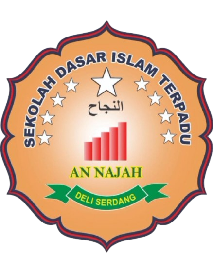
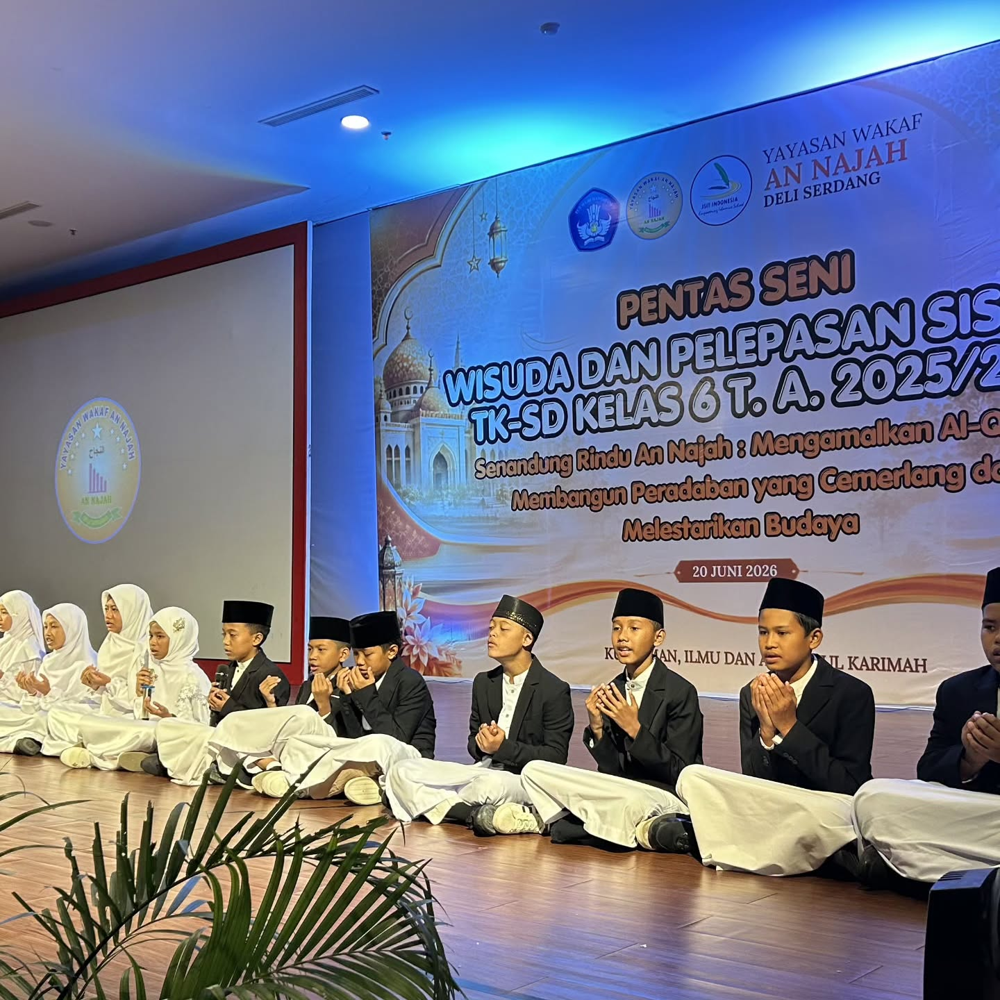

# Website Resmi SDIT AN NAJAH — Modern Corporate School

Website resmi profil sekolah **SDIT AN NAJAH** yang modern, elegan, profesional, cepat, ringan, responsif, dan mudah dikelola tanpa memerlukan build tools atau framework tambahan.

Website ini dibangun murni menggunakan **HTML5, CSS3, dan Vanilla JavaScript**.

---

## 📋 Identitas Resmi Sekolah

* **Nama Sekolah**: SDIT AN NAJAH
* **Slogan**: Kuat iman, ilmu, & akhlak
* **Nomor WhatsApp Resmi**: `0812-6444-6836` (`+62 812-6444-6836`)
* **Alamat**: Jln. Bejo, Gg. Sejahtera No. 26
* **Facebook**: [facebook.com/share/1BEJNhWWeT/](https://www.facebook.com/share/1BEJNhWWeT/)
* **YouTube**: [@tksdislamterpaduannajah7046](https://www.youtube.com/@tksdislamterpaduannajah7046)
* **Instagram**: [@sdit_annajah](https://www.instagram.com/sdit_annajah?igsi=MWxwYWVxcXhwMXFreA==)
* **TikTok**: [@sdit.annajah](https://www.tiktok.com/@sdit.annajah?_r=1&_t=ZS-99HSjbhWvzE)
* **Google Maps**: [TKIT dan SDIT An Najah Deli Serdang](https://maps.app.goo.gl/RRBmpdAoVanFdJpz9)

---

## 📁 Struktur Folder & Berkas

```text
sdit an najah/
│
├── index.html              # Struktur semantik halaman web utama
├── style.css               # Styling Modern Corporate, variabel warna, responsif & animasi
├── script.js               # Pengaturan data sekolah terpusat, Lightbox galeri, WhatsApp handler
├── README.md               # Panduan teknis pengoperasian & kustomisasi
│
└── images/                 # Direktori semua aset gambar
    ├── hero/
    │   └── hero-bg.svg     # Foto/banner utama di hero section (berwarna)
    │
    ├── kegiatan/           # Foto dokumentasi kegiatan sekolah
    │   ├── perayaan-1.svg & perayaan-2.svg
    │   ├── studytour-1.svg & studytour-2.svg
    │   ├── maulid-1.svg & maulid-2.svg
    │   └── upacara-1.svg & upacara-2.svg
    │
    └── logo/
        └── logo.svg        # Logo resmi sekolah
```

---

## 🚀 Cara Menjalankan Website

Website ini bersifat statis dan **dapat langsung dijalankan**:
1. Cukup klik ganda (double-click) berkas `index.html` untuk membukanya di browser apa pun (Google Chrome, Microsoft Edge, Mozilla Firefox, Safari, dll).
2. Atau gunakan ekstensi seperti **Live Server** di Visual Studio Code / Antigravity IDE jika ingin live preview.

---

## 🛠️ Panduan Kustomisasi & Perubahan Lanjutan

### 1. Objek Konfigurasi di `script.js`
Seluruh konfigurasi utama terpusat pada baris awal [script.js](file:///d:/project/sdit%20an%20najah/script.js):

```javascript
const schoolConfig = {
  name: "SDIT AN NAJAH",
  slogan: "Kuat iman, ilmu, & akhlak",
  whatsappNumber: "6281264446836",
  address: "Jln. Bejo, Gg. Sejahtera No. 26",
  social: {
    facebook: "https://www.facebook.com/share/1BEJNhWWeT/",
    youtube: "https://www.youtube.com/@tksdislamterpaduannajah7046",
    instagram: "https://www.instagram.com/sdit_annajah?igsi=MWxwYWVxcXhwMXFreA==",
    tiktok: "https://www.tiktok.com/@sdit.annajah?_r=1&_t=ZS-99HSjbhWvzE"
  },
  maps: {
    embedUrl: "https://www.google.com/maps/embed?pb=...",
    directionsUrl: "https://maps.app.goo.gl/RRBmpdAoVanFdJpz9"
  }
};
```

---

### 2. Mengganti Logo Sekolah
1. Simpan file logo asli sekolah Anda ke folder `images/logo/logo.png` atau `images/logo/logo.svg`.
2. Jika menggunakan format PNG/JPG, perbarui tag `` di `index.html`:
   ```html
   
   ```

---

### 3. Mengganti Foto Hero (Latar Belakang Utama)
1. Simpan foto gedung atau gerbang utama SDIT AN NAJAH beresolusi tinggi ke dalam folder `images/hero/gedung-sekolah.jpg`.
2. Perbarui baris berikut di `index.html`:
   ```html
   
   ```

---

### 4. Mengganti & Menambah Foto Galeri Kegiatan

#### Mengganti Foto yang Sudah Ada
1. Simpan foto dokumentasi asli SDIT AN NAJAH ke folder `images/kegiatan/`.
2. Buka `script.js`, perbarui daftar file foto pada objek `galleryData`:
   ```javascript
   const galleryData = {
     perayaan: {
       title: "Perayaan Hari Besar",
       photos: [
         "images/kegiatan/perayaan-1.jpg",
         "images/kegiatan/perayaan-2.jpg",
         "images/kegiatan/perayaan-3.jpg" // Bisa menambahkan lebih dari 2 foto
       ]
     },
     // ...
   };
   ```

#### Menambah Kegiatan Baru ke Galeri
1. **Tambahkan data di `script.js`**:
   ```javascript
   galleryData.tahfidz = {
     title: "Wisuda Tahfidz Al-Qur'an",
     photos: [
       "images/kegiatan/tahfidz-1.jpg",
       "images/kegiatan/tahfidz-2.jpg"
     ]
   };
   ```

2. **Tambahkan kartu di `index.html`** di dalam container `#fullActivityGrid`:
   ```html
   <article class="activity-card reveal" data-activity-id="tahfidz" tabindex="0" role="button" aria-label="Buka galeri Wisuda Tahfidz">
     <div class="activity-card-media">
       
       <div class="activity-card-badge">2 Foto</div>
       <div class="activity-card-overlay">
         <span class="view-btn">Buka Galeri</span>
       </div>
     </div>
     <div class="activity-card-info">
       <h3 class="activity-card-title">Wisuda Tahfidz Al-Qur'an</h3>
     </div>
   </article>
   ```

---

## 🎨 Palet Warna & Desain

Desain mengusung tema **Modern Corporate School** yang berwibawa dan bersih:
* **Primary / Accent Color**: `#FF7A00` (Orange) — tombol CTA, link aktif, badge, dan aksen garis.
* **Main Background**: `#FFFFFF` (Putih) — memberi kesan bersih, lapang, dan terpercaya.
* **Secondary Background**: `#F8FAFC` & `#F1F5F9` (Abu-abu sangat lembut).
* **Text / Heading / Footer**: `#0F172A` & `#1E293B` (Dark Slate).
